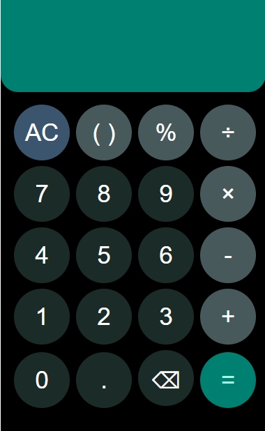

---
# 📱 Motorola Mobile's Style Calculator

A sleek and efficient calculator web application inspired by Motorola's mobile design. Built with **HTML**, **CSS**, **JavaScript**, and **PHP** for server-side expression evaluation.

🔗 **Live Demo:** [Try the Calculator Now 🚀](https://motorola-calculator.66ghz.com/)

---
## 🎯 Features

✅ Supports basic and advanced arithmetic operations: `+`, `-`, `*`, `/`, `%`, `()`.  
✅ Near-perfect UI resemblance to Samsung's calculator (90-96% accuracy).  
✅ Fully responsive design, optimized for mobile and desktop screens.  
✅ Backend processing using PHP for secure and accurate expression evaluation.  

---
---
## 🛠️ Tech Stack

- **Frontend:** HTML, CSS, JavaScript  
- **Backend:** PHP  
- **Hosting Platform:** [InfinityFree](https://infinityfree.net)  

---
## 📂 Project Structure

```
/samsung-calculator
│
├── index.php       # Main calculator UI and Backend PHP script for expression evaluation
├── style.css        # Custom styles for the Samsung-like design
└── script.js        # JavaScript for handling user interaction
    
```
---
## 🚀 How to Run Locally

1. **Clone the repository:**
   ```bash
   git clone https://github.com/trio-rds-tensors/Motorola-Calculator.git
   cd Motorola-Calculator
   ```

2. **Run a local PHP server:**
   ```bash
   php -S localhost:8000
   ```
   Visit `http://localhost:8000` in your browser.

---
## 🌄 UI Preview



---
## 🙌 Acknowledgements

Developed by [trio-rds-tensors](https://github.com/trio-rds-tensors)  
Special thanks to **InfinityFree** for free hosting.

---

## 📬 Connect with Me

- GitHub: [trio-rds-tensors](https://github.com/trio-rds-tensors)  
- Email: [machinelearning41819@gmail.com]  

---
